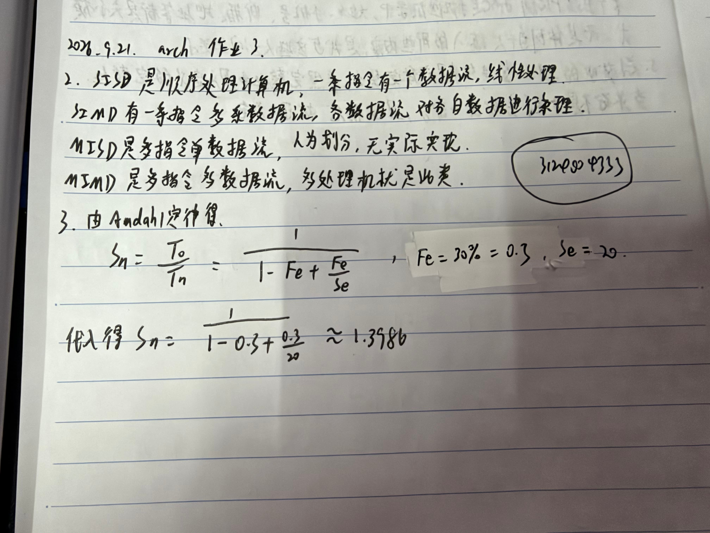

# 作业3

1. 自学教材 计算机系统结构的分类
2. 解释-Flynn分类法中的：  SISD,SIMD, MISD, MIMD
3. 计算 将计算机系统中某一功能的处理速度加快20倍，该功能的处理时间仅占整个系统运行时间的30%，则采用此增强功能方法后，能使整个系统的性能提高多少？
   1. 需要在纸张上答题并拍照，纸张上需要留有自己的信人信息。 照片压缩处理，单张照片文件大小不要超过1M。（也可以直接在手写板上做题）
4. 每次作业只在根目录需要一个md文档，这次作业的文件名是 “作业3.md”

## 作业解答

RT

