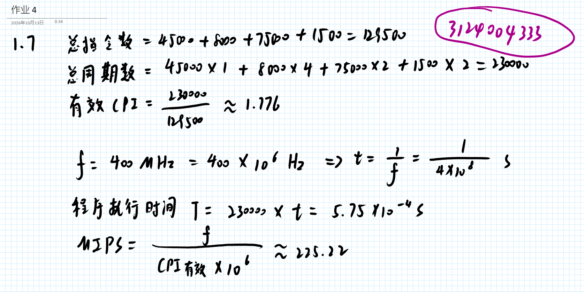
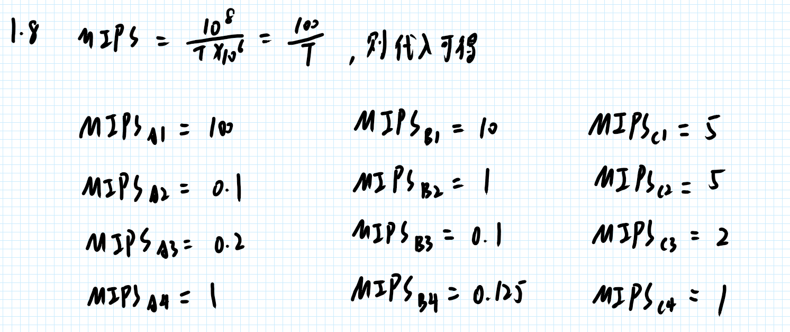
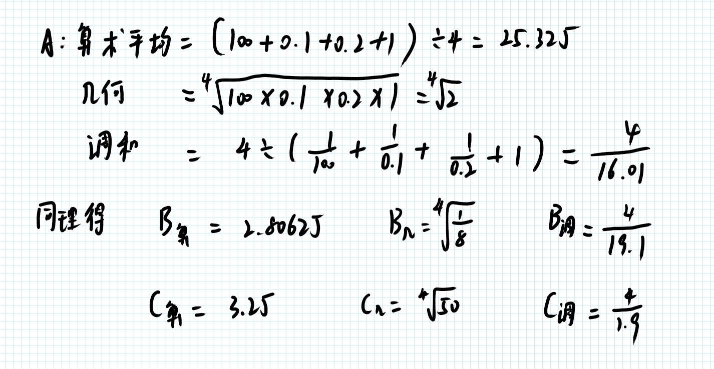
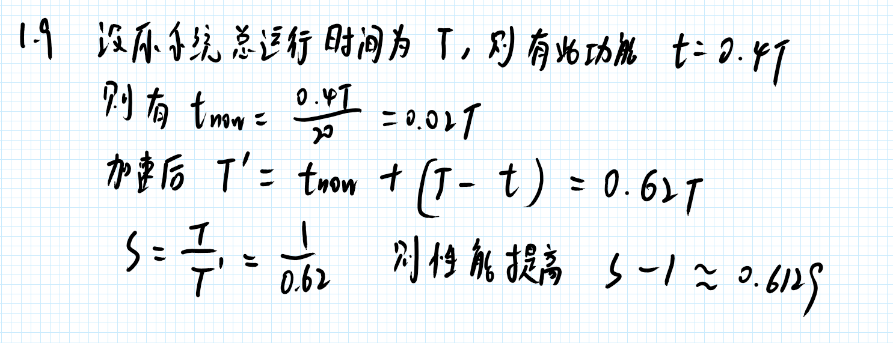
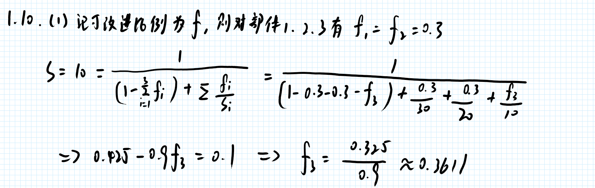
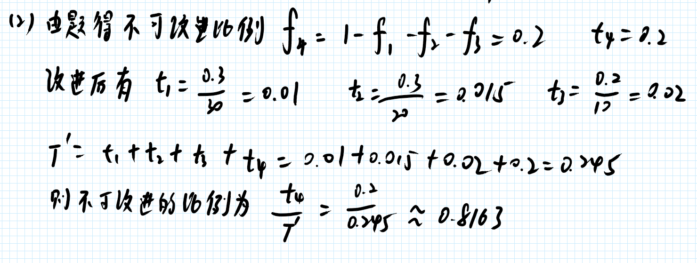
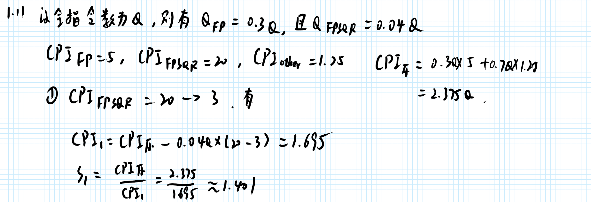
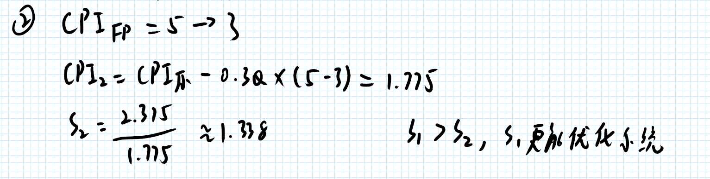

# 作业 4

1. 自学教材第一章剩余内容
2. 自学教材第二章 指令系统的设计 内容，熟悉MIPS指令系统的汇编指令
3. 完整教材第一章课后习题 1.7~1.11
	1. 需要在纸张上答题并拍照，纸张上需要留有自己的信人信息。 照片压缩处理，单张照片文件大小不要超过1M。（也可以直接在手写板上做题）
4. 每次作业只在根目录需要一个md文档，这次作业的文件名是 “作业4.md”

## 个人解答

