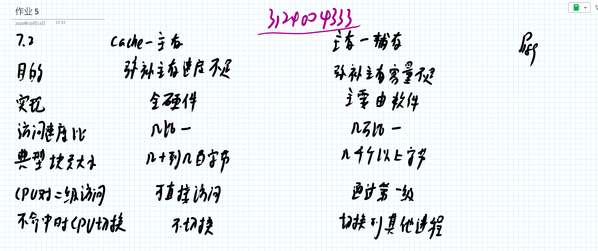
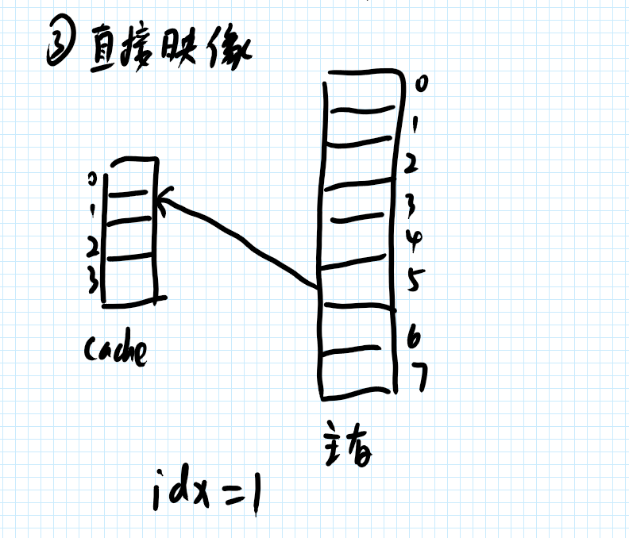

# 作业 5

1. 网上搜集资料，给出以下数据
	1. intel 哪款芯片开始有了一级高速缓存（cache）,容量是多少？
	2. intel 哪款芯片开始有了一级、二级高速缓存（cache）,容量分别是多少？
	3. intel 哪款芯片开始有了一级、二级、三级高速缓存（cache）,容量分别是多少？
	4. intel 最新款芯片高速缓存（cache）,容量分别是多少？
2. 完成教材习题 7.2， 7.4
	1. 需要在纸张上答题并拍照，纸张上需要留有自己的信人信息。 照片压缩处理，单张照片文件大小不要超过1M。（也可以直接在手写板上做题）
3. 每次作业只在根目录需要一个md文档，这次作业的文件名是 “作业5.md”

## 个人解答

1. Intel 缓存发展

- 1989 年的 Intel 80486 芯片开始出现 L1 Cache，大小是 8KB
- 1995 年的 Intel Pentium Pro 出现 L2 Cache，L1 和 L2 的 Cache 分别是 16KB 和 256KB
- 2007 年的 Intel® Itanium® Processor 9152M 出现 L3 Cache，L1、L2、L3 分别是 32KB、96KB 和 24MB
- 目前最新的为 Intel® Core™ Ultra X9 Processor 388H，标称为 18MB Intel® Smart Cache，查其他资料可以得到 L1 - L3 分别是 192KB、3MB、18MB

2. 如图

## Reference

- https://cdrdv2.intel.com/v1/dl/getContent/841923?fileName=Intel-Core-Desktop-Boxed-Processors-Comparison-Chart.xlsx
- https://zhuanlan.zhihu.com/p/464413953
- https://www.auslogics.com/en/articles/intel-processor-generations-in-a-timeline-history-and-evolution
- https://www.intel.com/content/www/us/en/products/sku/34655/intel-itanium-processor-9152m-24m-cache-1-66-ghz-667-mhz-fsb/specifications.html
- https://www.techpowerup.com/cpu-specs/core-ultra-x9-388h.c4302